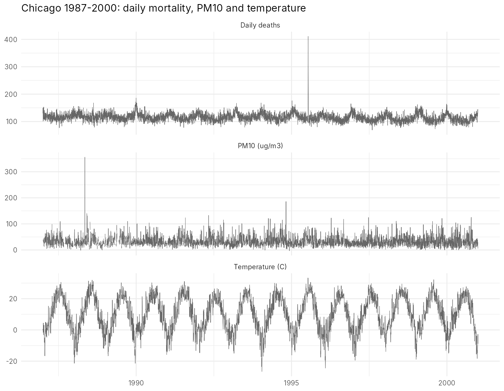
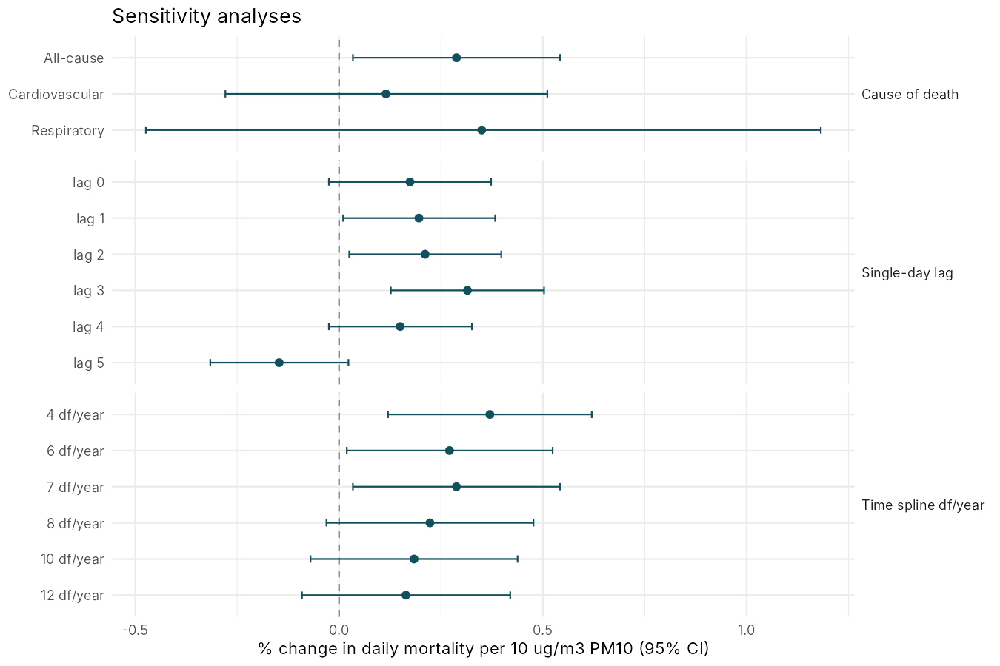
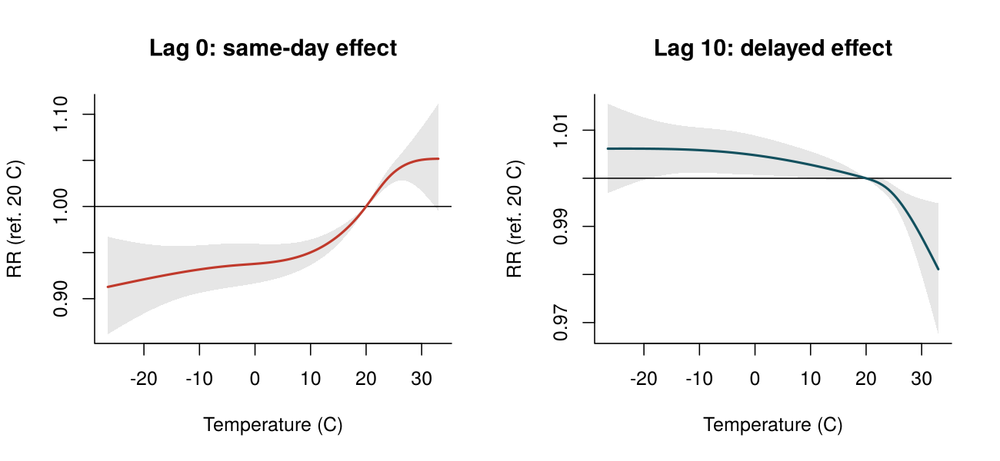
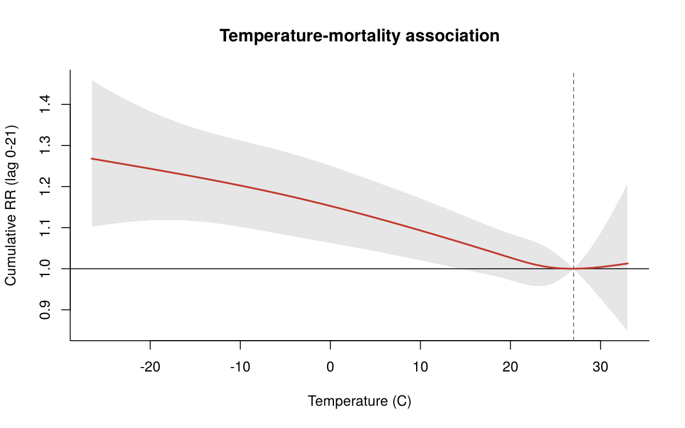

# Short-term effects of PM10 and temperature on daily mortality: Chicago, 1987–2000

A time-series analysis of how day-to-day changes in particulate air pollution (PM10) and temperature relate to daily deaths, using the classic methods of environmental epidemiology: quasi-Poisson regression with natural splines and distributed lag non-linear models (DLNM).

The approach mirrors my MSc thesis on African dust, particulate matter and mortality in Athens (poster at ISEE 2022), reproduced here on a public dataset so the full code can be shared.

## Data

`chicagoNMMAPS` from the [`dlnm`](https://cran.r-project.org/package=dlnm) R package: 5,114 days of all-cause, cardiovascular and respiratory deaths, PM10, temperature and humidity for Chicago, from the US National Morbidity, Mortality and Air Pollution Study (NMMAPS). No download needed.

| Variable | Mean (SD) | Median (IQR) | Missing days |
|---|---|---|---|
| All-cause deaths | 115.4 (15.3) | 114 (105–124) | 0 |
| PM10 (µg/m³) | 33.7 (19.3) | 30.3 (20.8–42.4) | 251 |
| Temperature (°C) | 10.1 (10.8) | 10.6 (1.7–19.4) | 0 |



The spike in July 1995 is the Chicago heat wave (411 deaths on 15 July, against a typical 114).

## Methods

**Main model.** Quasi-Poisson regression of daily deaths on PM10 (mean of the same and previous day, lag01), adjusting for:
- long-term trend and seasonality: natural spline of time, 7 df per year
- temperature: natural splines of same-day (6 df) and previous 1–3 days (3 df)
- day of the week

Overdispersion is handled by the quasi-Poisson scale parameter (1.31).

**Sensitivity analyses.** Single-day lags 0–5; 4 to 12 df per year for seasonality; cardiovascular and respiratory deaths.

**Distributed lag models.** A cross-basis for PM10 (linear, lags 0–10) and for temperature (natural spline in both temperature and lag, lags 0–21), to separate immediate from delayed effects.

## Results

### PM10

A **10 µg/m³ increase in PM10 (lag01) was associated with a 0.29% increase in daily mortality (95% CI 0.03 to 0.54%)**.



- The effect is spread over lags 1–3 and turns slightly negative at lag 5, which is compatible with some short-term mortality displacement ("harvesting").
- The estimate shrinks as seasonality control gets stricter (0.37% at 4 df/year to 0.16% at 12 df/year), a known sensitivity of these models, and the confidence interval includes zero from 8 df/year onwards.
- Cause-specific estimates are imprecise, because daily counts are much smaller (about 51 cardiovascular and 9 respiratory deaths a day).
- Over lags 0–10 in the distributed lag model the cumulative estimate is 0.39% (95% CI −0.26 to 1.04%).

### Temperature

| Temperature | Lags 0–3 | Lags 0–21 |
|---|---|---|
| Extreme heat (99th pct, 28.5 °C) | **RR 1.08** (1.07–1.09) | RR 1.00 (0.97–1.04) |
| Extreme cold (1st pct, −15 °C) | RR 0.99 (0.94–1.03) | **RR 1.22** (1.12–1.34) |

Relative risks are compared with the minimum mortality temperature (27 °C).



Heat acts within days, then the excess largely disappears over the following weeks, consistent with deaths brought forward among frail people. Cold acts slowly, with the excess building up over 1–3 weeks and persisting.



## Limitations

- Ecological time-series design: associations at population level, not individual risk.
- PM10 is measured at fixed monitors, so personal exposure is misclassified.
- The 1995 heat wave is an extreme event that strongly influences the heat estimates.
- Results depend on modelling choices (df for seasonality, lag length), shown in the sensitivity analyses.

## How to run

```r
install.packages(c("dlnm", "ggplot2"))
source("run_all.R")   # writes figures/ and results/
```

| File | Content |
|---|---|
| `R/01_descriptive.R` | Summary statistics and time-series plots |
| `R/02_main_model.R` | Main quasi-Poisson model and residual diagnostics |
| `R/03_sensitivity.R` | Lags, seasonality df and cause-specific models |
| `R/04_dlnm.R` | Distributed lag non-linear models for PM10 and temperature |

## References

- Gasparrini A, Armstrong B, Kenward MG. Distributed lag non-linear models. *Statistics in Medicine* 2010;29:2224–2234.
- Bhaskaran K, Gasparrini A, Hajat S, Smeeth L, Wilkinson P, Armstrong B. Time series regression studies in environmental epidemiology. *International Journal of Epidemiology* 2013;42:1187–1195.
- Peng RD, Dominici F. *Statistical Methods for Environmental Epidemiology with R*. Springer, 2008.

---
Viktor Levis · Biostatistician · [LinkedIn](https://www.linkedin.com/in/viklevis/)
